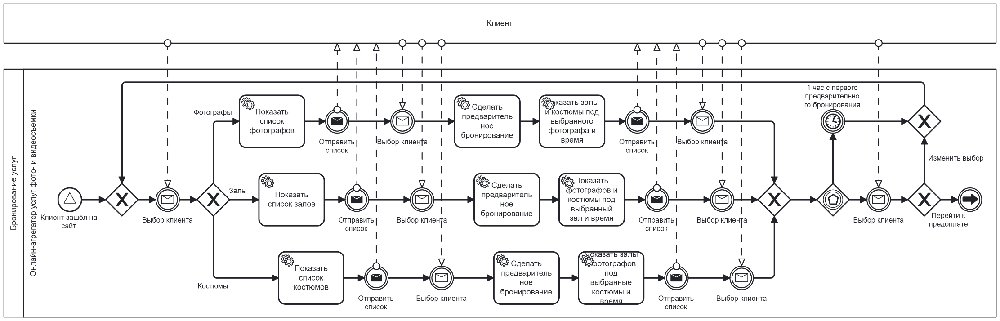
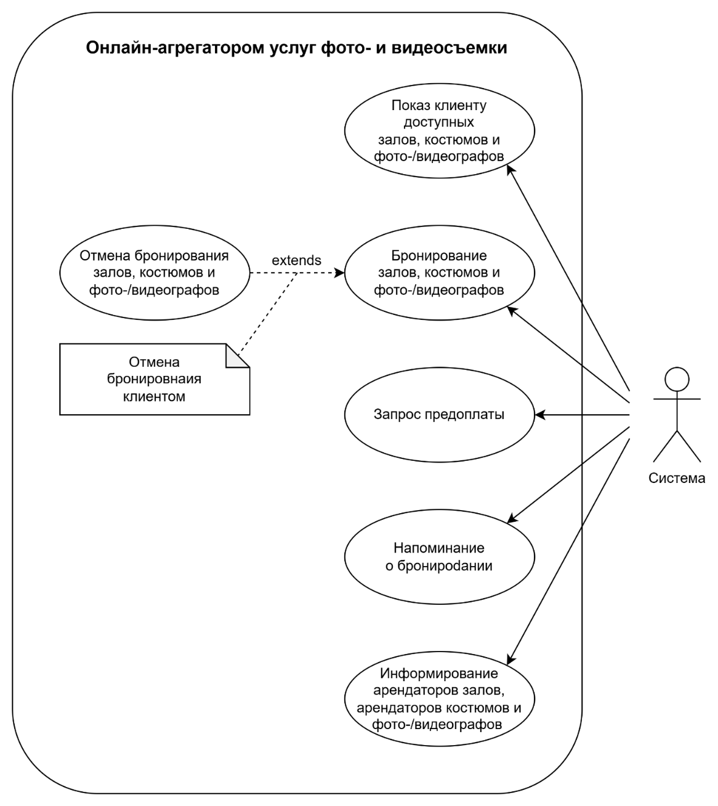
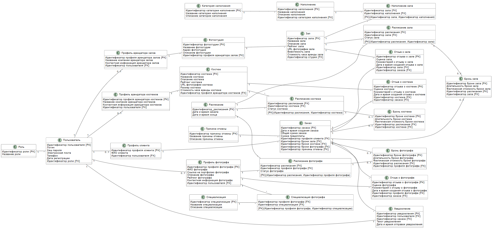
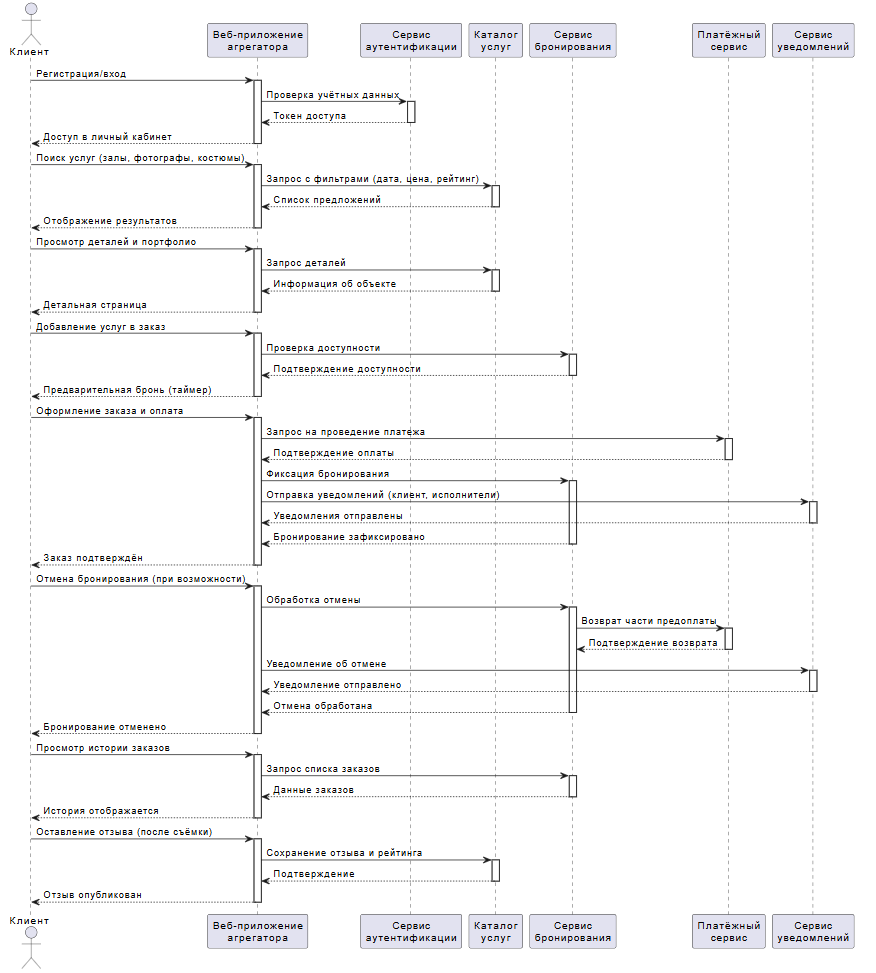
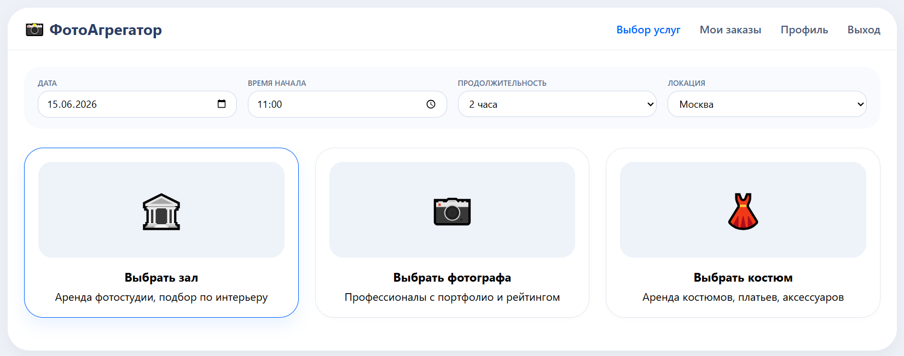
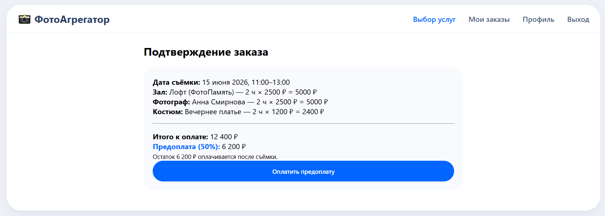
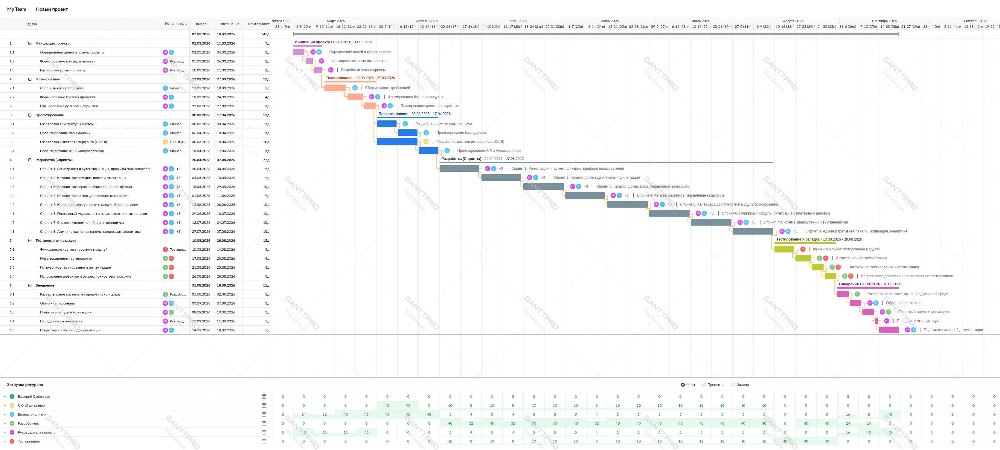

# Онлайн-агрегатор услуг фото- и видеосъёмки

Магистерская выпускная работа, МИРЭА, 2026.

## Задача

Типовая сеть фотостудий работает в учётной системе «1С:Предприятие 8. Фотоуслуги и сувениры», а услуги разрозненны: сквозного бронирования комплекса «зал, фотограф, костюмы» нет.
Нужно было спроектировать онлайн-агрегатор, где клиент собирает съёмку целиком в одном заказе.

## Что я сделал

**Обследование.** Описал организационную структуру сети, карту процессов верхнего уровня, карту систем и фрагмент ИТ-архитектуры.

**Процессы AS-IS и TO-BE.** Смоделировал процесс «Бронирование услуг» в BPMN 2.0 в двух состояниях и построил диаграммы вариантов использования для текущей системы и для агрегатора.

**Требования.** Собрал функциональные и нефункциональные требования, в том числе работу не менее 1000 пользователей одновременно без снижения скорости.

**Архитектура.** Сравнил монолит и микросервисы и выбрал микросервисную архитектуру: PostgreSQL 15, документированный REST API, размещение в Яндекс Облаке.

**Данные.** Построил концептуальную, логическую и физическую модели данных и проверил их SQL-запросами: поиск свободных залов, детали заказа, загрузка залов, рейтинг фотографов.

**Поведение системы.** Описал диаграммы последовательности для четырёх ролей: клиент, фотограф, арендатор залов, арендатор костюмов.

**Прототип.** Нарисовал 18 экранных форм: выбор услуг, карточки залов, фотографов и костюмов, оформление заказа, личные кабинеты исполнителей. Плюс документы и уведомления: подтверждение брони, напоминание о съёмке, ежемесячный отчёт о загрузке.

**План проекта.** Составил иерархическую структуру работ и календарный план на 141 рабочий день, оценил проект в 3 258 308 ₽ с учётом резерва, описал риски и стейкхолдеров.

## Файлы

- `bpmn/Photo_ASIS.bpmn`, `bpmn/Photo_TOBE.bpmn`: исходники процессов, открываются в Camunda Modeler или на bpmn.io.
- `images/`: диаграммы и формы из работы.
