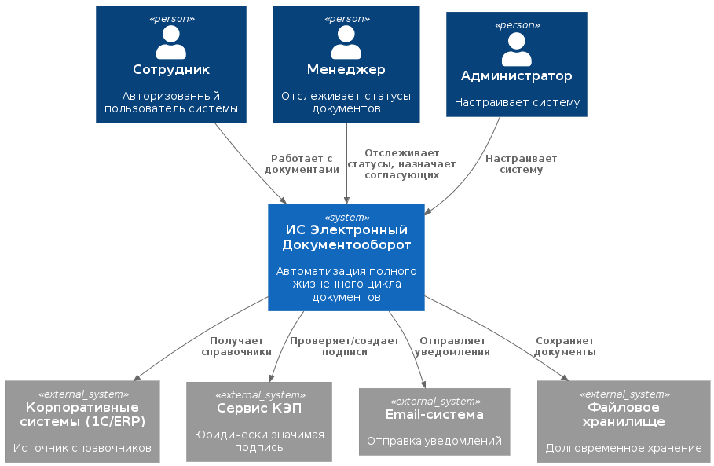
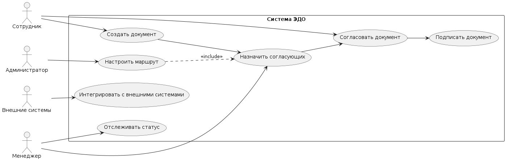
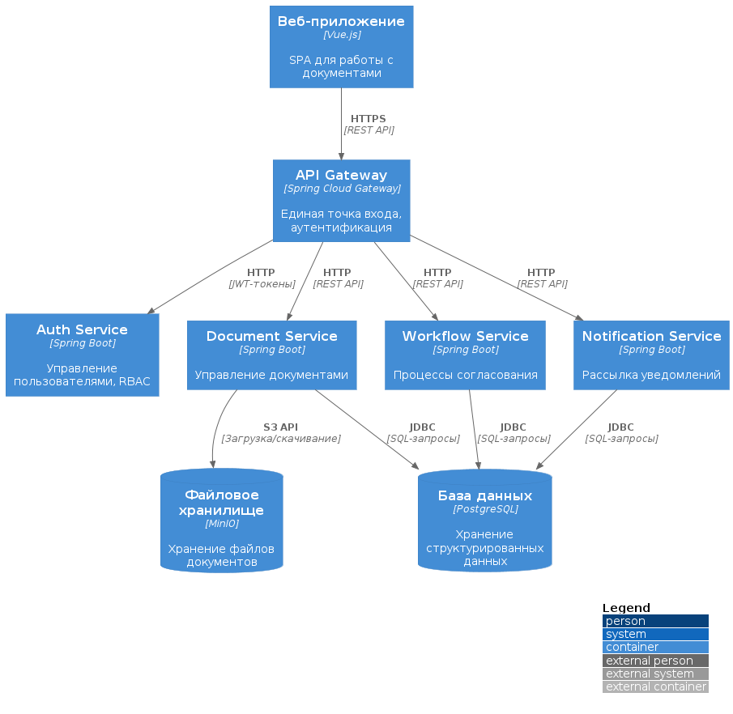
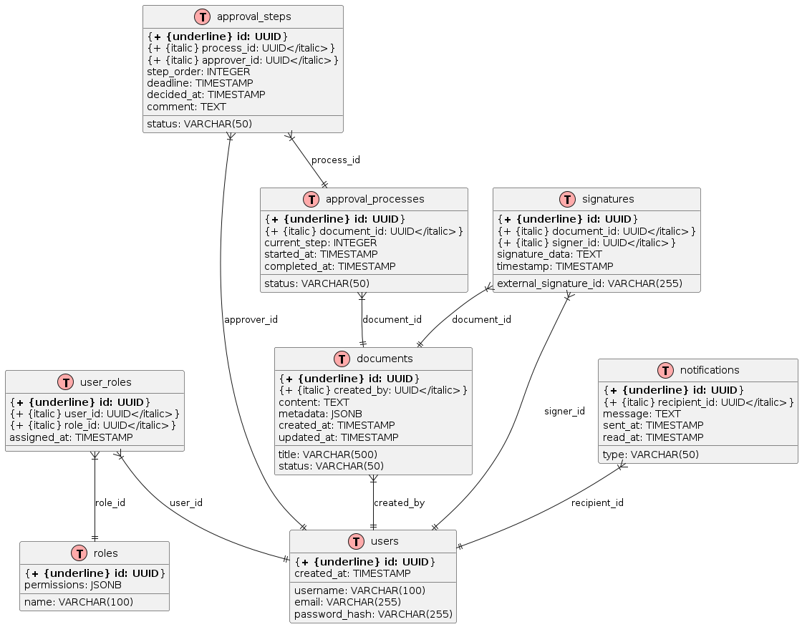
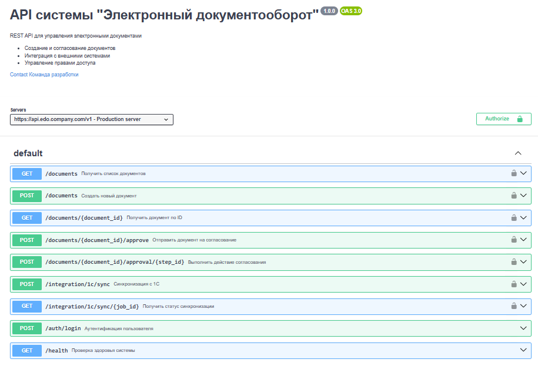
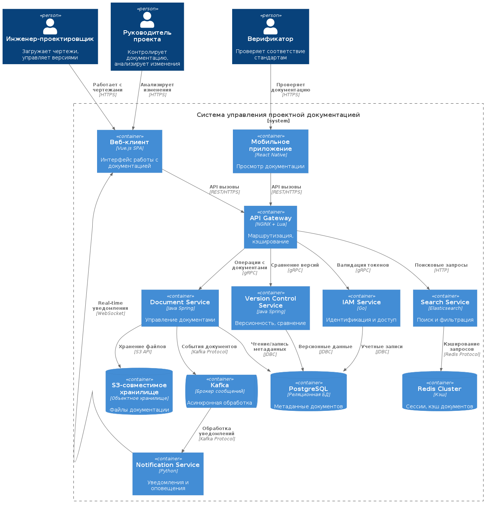
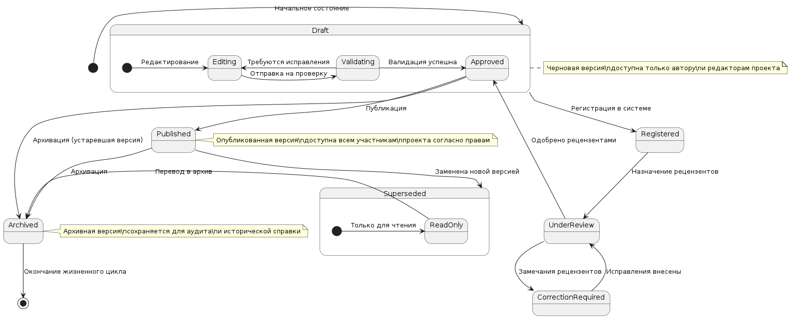

# Система электронного документооборота

Цикл из восьми практических работ, магистратура МИРЭА.

## Задача

Спроектировать ИС электронного документооборота класса ECM: создание, согласование и подписание документов, интеграция с корпоративными системами.

## Что я сделал

**Контекст и требования.** Контекстная диаграмма, варианты использования, нефункциональные требования: отклик не более 2 секунд на операции с документами, до 1000 пользователей одновременно, доступность 99,9%.

**Модель и архитектура.** Прошёл цепочку CIM, PIM, PSM. Диаграммы классов, последовательности и развёртывания. Стек в модели: Java 17, Spring Boot 3, PostgreSQL 15, Redis, RabbitMQ, MinIO, Docker. Интеграции с 1С/ERP, сервисом КЭП, почтой и файловым хранилищем.

**Данные и API.** ER-диаграмма, список эндпоинтов, каркасы DTO. Контракт взаимодействия описан в OpenAPI 3.0 с ключом идемпотентности и версионированием: [`openapi.yaml`](openapi.yaml).

**Поведение.** Динамическая диаграмма C4, диаграмма состояний запроса на создание документа, схемы мониторинга, аутентификации и авторизации.

**DDD.** Event Storming, поддомены, контекст-карта, агрегаты и доменные события, архитектура портов и адаптеров.

## Файлы

- `openapi.yaml`: спецификация API, открывается в Swagger Editor.
- `images/`: диаграммы из работ.
