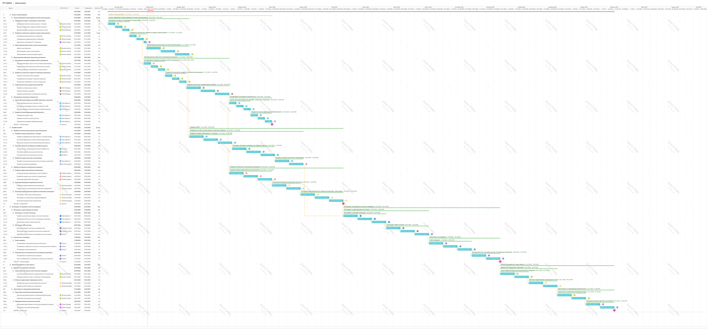
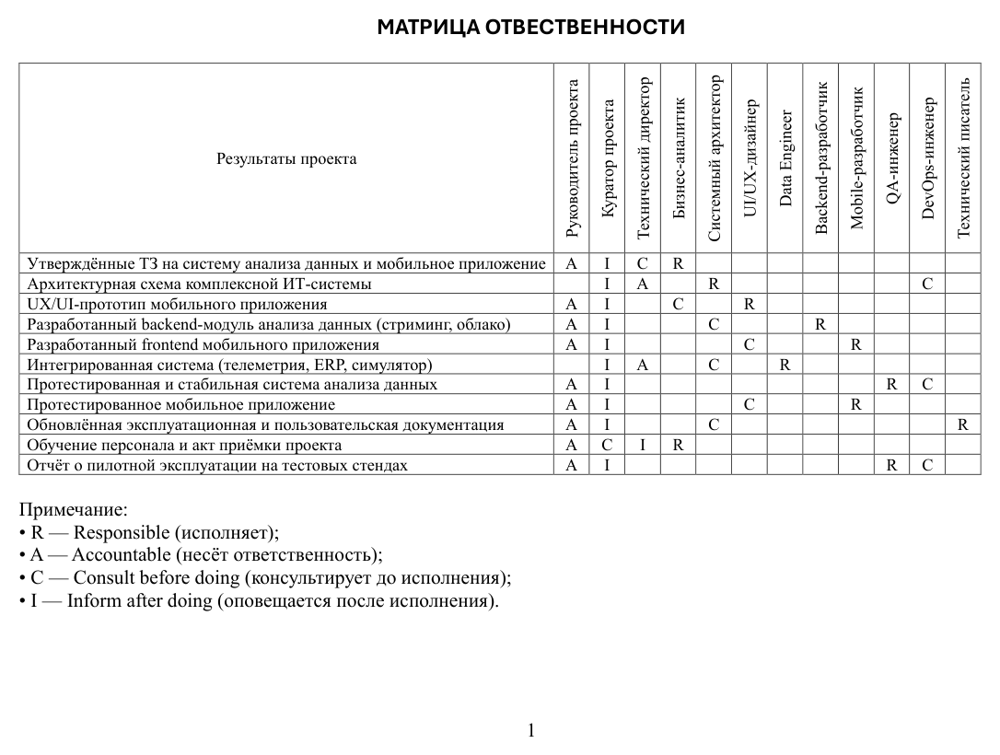
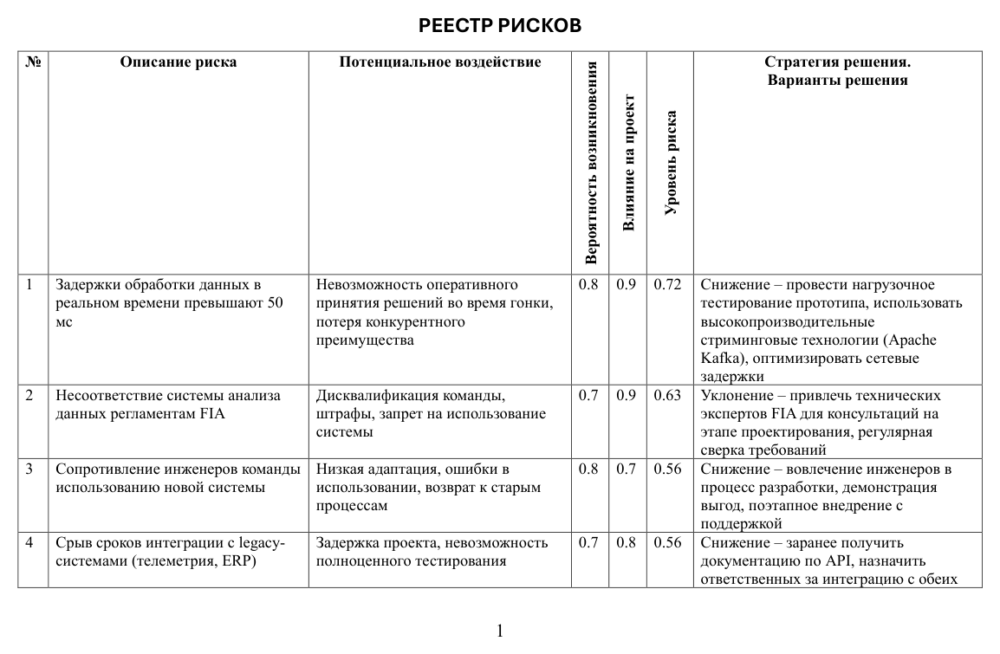
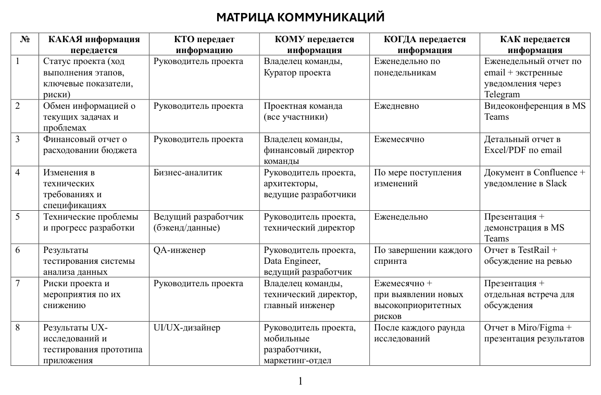

# Платформа анализа телеметрии и приложение для болельщиков гоночной команды

Учебный проект по управлению ИТ-проектами, магистратура МИРЭА. Заказчик условный: команда Формулы-1 «AeroRacing».

## Задача

Подготовить проект комплексной ИС: облачная система анализа данных с болида в реальном времени и мобильное приложение для болельщиков.

## Что я сделал

**Концепция.** Сформулировал измеримые цели:
- сбор, обработка и визуализация данных с более чем 200 сенсоров болида с задержкой не более 50 мс;
- мобильное приложение с лентой новостей и отслеживанием гонок в реальном времени, рост вовлечённости аудитории на 40% за 6 месяцев после релиза;
- полная интеграция новых модулей с ERP-системой и симулятором команды.

Расписал задачи, результаты и вопросы к заказчику.

**План работ.** Разбил проект на этапы: анализ и проектирование, разработка MVP, интеграция, тестирование и пилотное внедрение, финальная доработка и сдача. Собрал календарный план с исполнителями и вехами.

**Матрица ответственности RACI.** 11 результатов проекта на 12 ролей, от руководителя проекта до технического писателя.

**Реестр рисков.** Технические, организационные и бюджетные риски с оценкой вероятности, влияния и уровня, стратегией и вариантами решения.

**Матрица коммуникаций.** Какая информация передаётся, кем, кому, когда и в какой форме.

