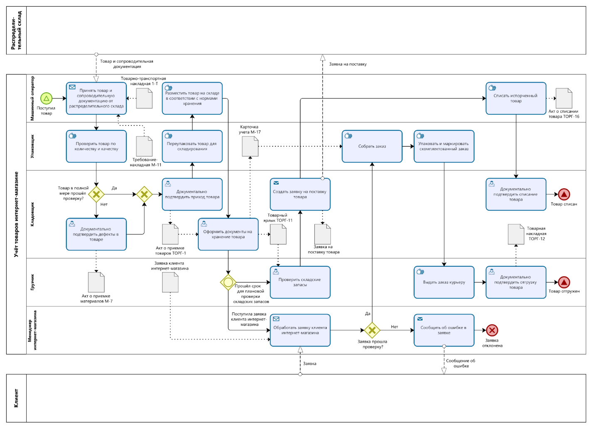
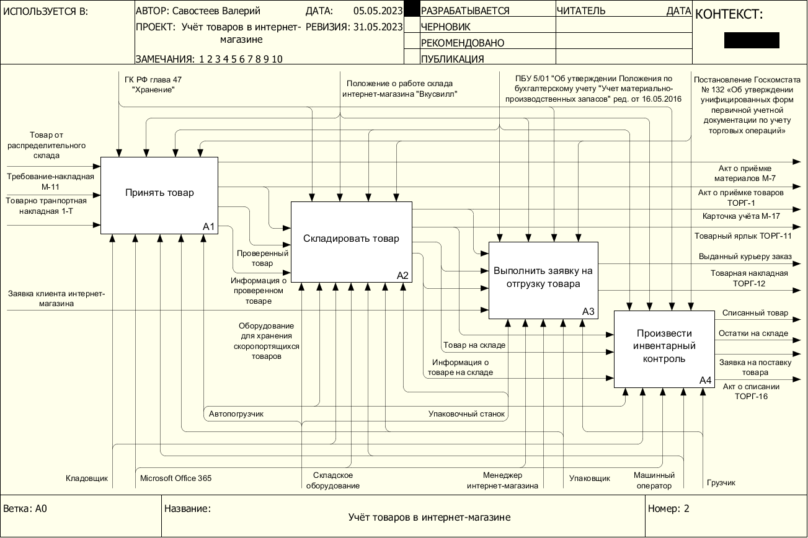
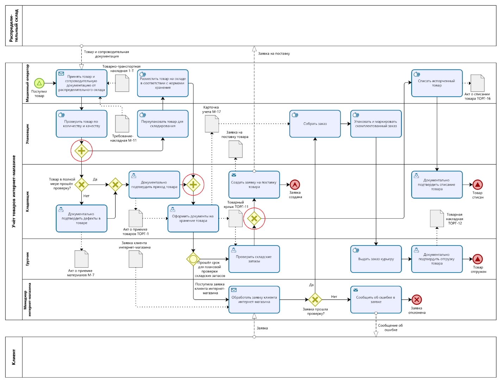
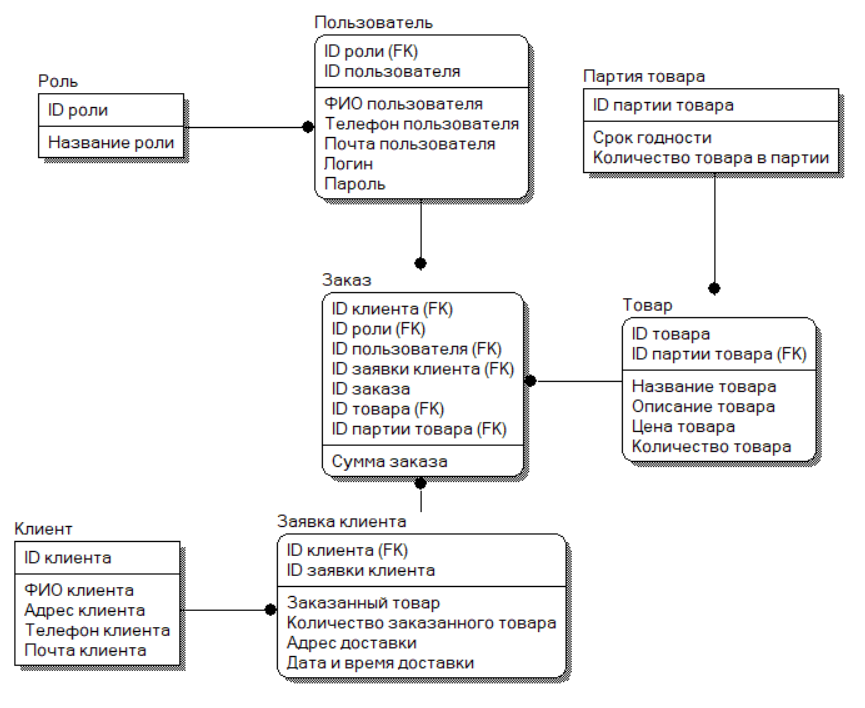
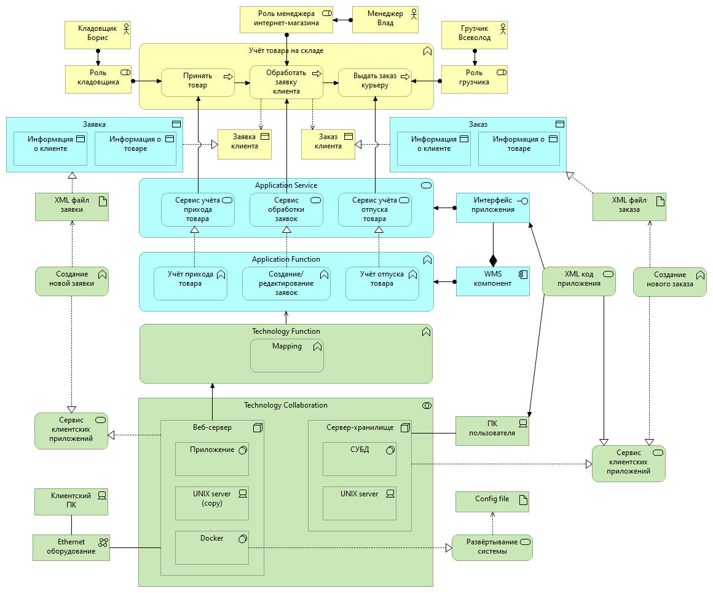

# Учёт товаров на складе интернет-магазина ВкусВилл

Две курсовые (6 и 7 семестр) и практические работы, бакалавриат МИРЭА.

## Задача

Разобрать процесс «Учёт товаров в интернет-магазине», найти узкие места и спроектировать модуль WMS, который их закрывает.

## Что я сделал

**Анализ.** SWOT-анализ, модель AS-IS в трёх нотациях: IDEF0 (Ramus), eEPC (ARIS Express), BPMN 2.0 (Bizagi). Декомпозировал подпроцессы приёмки, складирования, отгрузки и инвентаризации.

**Процесс TO-BE.** Перестроил процесс: приёмка и складирование объединены в один подпроцесс, документооборот привязан к унифицированным формам (ТОРГ-12, ТОРГ-13, М-11 и другие).

**Модуль WMS.** Функциональные требования, ER-модель в нотации Чена, логическая и физическая модели данных (ERwin, MySQL Workbench), классификатор партии товара, прототип интерфейса в Figma.

**Архитектура ИС.** Слои бизнеса, приложений и технологий с интеграциями.

